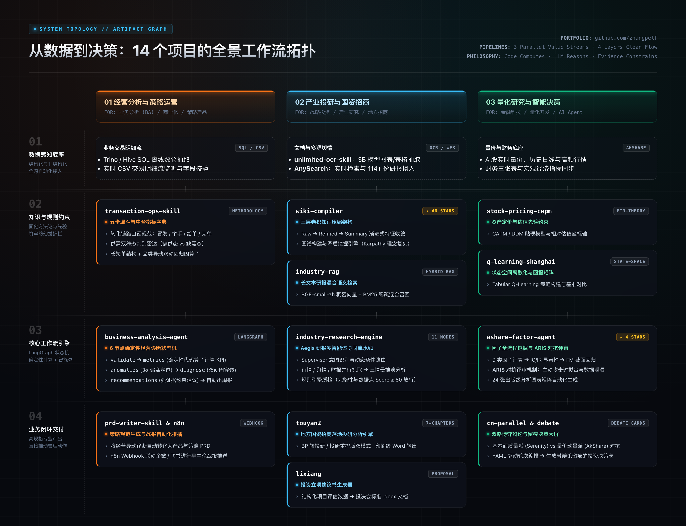

# Hi there, I'm Peifu Zhang (张培福) 👋

  <strong>产业经济学硕士（南京理工大学） ｜ 金融学学士（双学位/含保险学）</strong> 
  <em>专注业务经营分析 (BA) · 平台商业化策略 · 产业投资研究 · LLM Multi-Agent 系统工程</em>

  
  
  
  

---

## 🗺️ 全景系统架构与工作流拓扑 (System Topology)

  

## 🎯 核心能力与定位

我的工作与开源项目聚焦于将**严谨的商业经营洞察、产业投研方法论**与**现代软件工程 / LLM Multi-Agent 架构**深度融合：
- **拒绝“把大模型当计算器”**：核心 KPI 测算、异动识别与量化回测必须由确定性代码/算子严谨执行；大模型专注语义归因、上下文综合与结构化推演。
- **证据链强约束 (Evidence-Constrained)**：所有经营与投资建议严格绑定结构化数据证据，杜绝大模型胡言与业务幻觉。
- **全链路闭环实践**：从数据底座提取、指标漏斗拆解、量利平衡建模，到自动化报告生成与 Agent 战报推播。

---

## 🗺️ 项目矩阵与求职能力版图

```mermaid
graph TD
    User["👨‍💻 张培福 (GitHub 作品集)"]
    
    User --> T1["📊 赛道一：经营分析与商业策略"]
    User --> T2["📈 赛道二：产业投研与量化决策"]
    User --> T3["🧠 赛道三：AI Agent 与知识工程基础设施"]

    T1 --> P1["<a href='https://github.com/zhangpelf/business-analysis-agent'>business-analysis-agent</a><br/><b>LangGraph 经营分析 Agent</b><br/>自动化 KPI 校验 / 异常归因 / 报告闭环"]
    T1 --> P2["<a href='https://github.com/zhangpelf/transaction-ops-skill'>transaction-ops-skill</a><br/><b>交易中台全链路运营方法论</b><br/>五步转化漏斗 / 供需双稳态 / 量利归因"]
    T1 --> P3["<a href='https://github.com/zhangpelf/prd-writer-skill'>prd-writer-skill</a><br/><b>n8n + Claude Code 自动 PRD 系统</b><br/>双组件敏捷需求与策略产品规范生成"]

    T2 --> P4["<a href='https://github.com/zhangpelf/touyan2'>touyan2</a><br/><b>产业落地投研分析引擎</b><br/>地方政府/国资招商落地 7 章节自动化框架"]
    T2 --> P5["<a href='https://github.com/zhangpelf/lixiang'>lixiang</a><br/><b>投资立项建议书生成器</b><br/>结构化项目数据 ➔ 标准化建议书 (.docx)"]
    T2 --> P6["<a href='https://github.com/zhangpelf/industry-research-engine'>industry-research-engine</a><br/><b>实时研报生成引擎</b><br/>LangGraph 4节点检索综合 + Streamlit 看板"]
    T2 --> P7["<a href='https://github.com/zhangpelf/ashare-factor-agent-workflow'>ashare-factor-agent-workflow</a><br/><b>A股量化因子挖掘与回测</b><br/>IC/IR/FM回归 + 24张出版级图表 + 对抗评审"]

    T3 --> P8["<a href='https://github.com/zhangpelf/wiki-compiler'>wiki-compiler (★46)</a><br/><b>三层卷积知识架构</b><br/>图谱与矛盾引擎 / Karpathy 知识库理念复刻"]
    T3 --> P9["<a href='https://github.com/zhangpelf/industry-rag'>industry-rag</a><br/><b>研报混合语义检索与问答</b><br/>bge-small-zh + BM25 混合向量检索系统"]
    T3 --> P10["<a href='https://github.com/zhangpelf/debate-platform'>debate-platform</a><br/><b>多智能体协同辩论框架</b><br/>YAML 驱动的双模型对抗式推理平台"]
```

---

### 📊 赛道一：经营分析与商业策略 (Business Analytics & Operations)

面向 **业务分析 (BA) / 经营分析 / 商业化策略 / 策略产品** 岗位，沉淀全链路转化漏斗与量利归因能力：

| 核心项目 | 架构与技术栈 | 核心解决问题与业务价值 |
| :--- | :--- | :--- |
| **[business-analysis-agent](https://github.com/zhangpelf/business-analysis-agent)** 经营分析工作流引擎 | LangGraph, Python, Docker, Pytest | 将 CSV 数据校验 $\to$ 核心 KPI 算子 $\to$ 异常波动识别 $\to$ 驱动因素归因 $\to$ 证据约束建议 $\to$ Markdown/HTML 周报生成，封装为离线确定性的工作流闭环。 |
| **[transaction-ops-skill](https://github.com/zhangpelf/transaction-ops-skill)** 交易中台运营与分析技能 | Markdown, CEL, 指标字典, 策略SOP | 抽象双边交易中台完整的“曝光-下单-响应-派发-交付”五步转化漏斗、供需双稳态（缺供/缺需）迁移判别、以及长短单与品类结构的“营收-利润双动因”归因分析模型。 |
| **[prd-writer-skill](https://github.com/zhangpelf/prd-writer-skill)** 自动化 PRD 写作系统 | n8n, Claude Code, Webhook | 专为策略运营与产品经理设计的双组件架构：Skill 负责业务逻辑与指标埋点生成，n8n 负责多端存储、通知与版本归档。 |

---

### 📈 赛道二：产业投研与量化决策 (Industrial Research & Quant Intelligence)

面向 **战略投资 / 产业研究 / 券商基金投研 / 国资招商 / 金融科技** 岗位：

| 核心项目 | 架构与技术栈 | 核心解决问题与业务价值 |
| :--- | :--- | :--- |
| **[touyan2](https://github.com/zhangpelf/touyan2)** 产业落地投研分析引擎 | Python, python-docx, CLI, Schema | 面向地方政府/国资招商项目的 7 章节投研分析标准引擎。支持“商业计划书转投研报告”与“投研重排版”双模式，内置尽调清单与落地政策对齐矩阵。 |
| **[lixiang](https://github.com/zhangpelf/lixiang)** 投资立项建议书生成器 | Python, Docx 渲染器, JSON Schema | 将结构化企业财务与技术评估数据，一键排版生成标准投资立项建议书文档，服务投决会决策流转。 |
| **[industry-research-engine](https://github.com/zhangpelf/industry-research-engine)** 实时语义研报生成引擎 | LangGraph, Streamlit, AnySearch | 输入行业关键词，自动调度 4 节点工作流完成公网多源检索、数据清洗、多层总结与交互式 HTML 研报导出。 |
| **[ashare-factor-agent-workflow](https://github.com/zhangpelf/ashare-factor-agent-workflow)** 量化因子挖掘与回测引擎 | Python, Pandas, Statsmodels, Matplotlib | 完整覆盖 6 阶段量化流程：IC/IR 分析、分组收益回测、Fama-MacBeth 截面回归，并引入 ARIS 对抗式评审机制，生成 24 张出版级图表。 |
| **[cn-parallel-analysis](https://github.com/zhangpelf/cn-parallel-analysis)** 双路并行股票分析 Skill | Python, AkShare, LLM Debate | 方法论派（质量与财务健康）与因子派（量价市场行为）双路并行辩论，生成带决策留痕对比卡。 |

---

### 🧠 赛道三：AI Agent 与知识工程基础设施 (AI Systems & Infrastructure)

面向 **AI Agent 工程师 / 知识库与 RAG 架构 / 数字化解决方案** 岗位：

| 核心项目 | 架构与技术栈 | 核心解决问题与业务价值 |
| :--- | :--- | :--- |
| **[wiki-compiler](https://github.com/zhangpelf/wiki-compiler)** ⭐ **46 Stars** 三层卷积知识架构 | Python, AST, Graphviz, Markdown | 借鉴 CNN 感受野逐层收敛思想，构建 Raw $\to$ Refined $\to$ Summary 三层渐进式知识压缩与图谱矛盾挖掘系统，终结数字化知识囤积。 |
| **[industry-rag](https://github.com/zhangpelf/industry-rag)** 研报语义检索与问答系统 | BGE-small-zh, BM25, FastAPI, FAISS | 针对长文本产业研报的混合检索问答底座，解决单纯关键词检索召回率低及纯向量检索精度漂移问题。 |
| **[debate-platform](https://github.com/zhangpelf/debate-platform)** 多智能体协同辩论框架 | Python, YAML Workflow, Multi-Agent | 基于结构化角色与辩论轮次配置的多 Agent 对抗决策平台，提升复杂商业判断的置信度。 |
| **[unlimited-ocr-skill](https://github.com/zhangpelf/unlimited-ocr-skill)** 无限制深度 OCR 工具 | Baidu OCR 3B, SGLang, OpenCode | 高吞吐图表、财报扫描件及复杂表格的一站式结构化提取技能。 |

---

## 🛠️ 技能栈与工具箱 (Skills & Tooling)

- **商业与策略分析**：业务转化漏斗拆解 · 供需动态定价 · 量利平衡归因 · 财务尽调与估值建模 (DCF / 可比公司) · 招商落地评估
- **算法与系统工程**：LangGraph · Multi-Agent 编排 · 混合检索 RAG · 状态机工作流 · Docker · Pytest 自动化测试
- **数据分析与编程**：Python (Pandas, NumPy, Scikit-learn, Statsmodels) · SQL (Trino, Hive, MySQL) · Git · Linux CLI

---

## 📫 联系与交流

- **教育经历**：
  - 南京理工大学 · 产业经济学 硕士 (2024 - 2027)
  - 山东工商学院 · 金融学 学士 (含保险学) (2019 - 2023)
- **求职方向**：经营分析 (BA) / 商业策略 / 产业投资与投研 / AI Agent 应用工程
- **主页与作品集**：[https://github.com/zhangpelf](https://github.com/zhangpelf)
